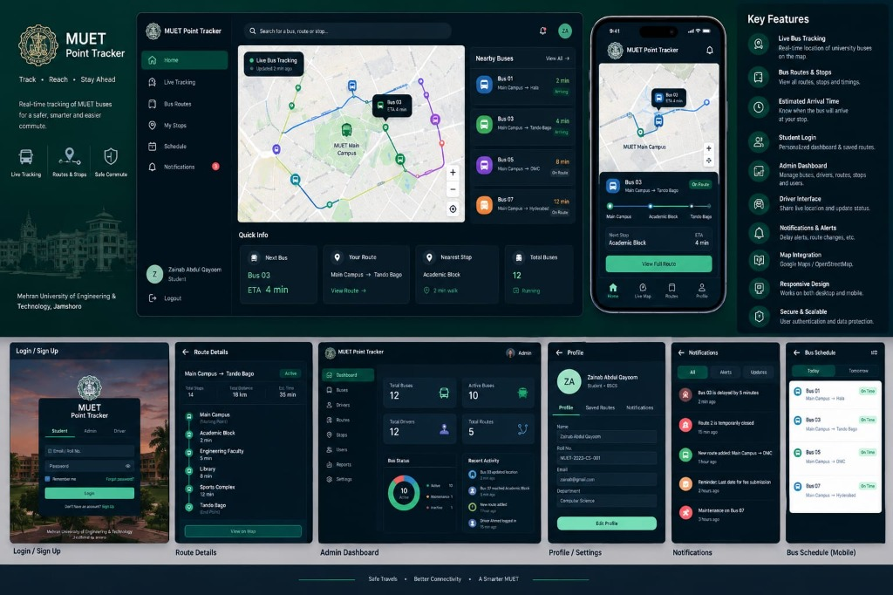

# 🚌 MUET Point Tracker — Mehran University Real-Time Bus Tracking System

> **"Track • Reach • Stay Ahead"**  
> *Official Student, Driver & Fleet Transit Management System for Mehran University of Engineering & Technology (MUET), Jamshoro, Pakistan.*



---

## 📌 Executive Summary & Architecture

**MUET Point Tracker** is a production-ready, full-stack campus transit management application engineered for Mehran University of Engineering & Technology, Jamshoro. It connects over 6,000 university students, bus drivers, and campus transport administrators with real-time bus locations, arrival predictions, automated route timetables, incident alerting, and role-based access control.

### Core Architectural Highlights:
1. **Frontend:** React 18 SPA styled with Tailwind CSS, animated with Lucide icons, and powered by Leaflet.js / OpenStreetMap with custom MUET campus cartography.
2. **Backend:** Lightweight, zero-external-dependency Node.js HTTP server (`server/server.js`) with RESTful JSON API handling (`server/apiHandler.js`).
3. **Database Engine:** High-performance embedded SQLite database via Node's native `node:sqlite` engine with WAL (Write-Ahead Logging) mode, foreign key constraints, and automatic schema initialization.
4. **Security & Authentication:**
   - Cryptographically random 16-byte salt with Node `crypto.scryptSync` key derivation for password hashing (`scrypt:<salt>:<hash>`).
   - Constant-time verification (`crypto.timingSafeEqual`) to prevent timing attack vulnerabilities.
   - HMAC-SHA256 signed JWT tokens with 7-day expiration.
   - Strict Role-Based Access Control (RBAC): Public registration is restricted to **Student** role only. Administrative fleet operations require verified **Admin** tokens.
   - Passwords and security hashes are strictly filtered out of all API endpoints and database responses.
5. **Authentic MUET Institutional Branding:**
   - Official full-screen university entrance gate photograph background.
   - Official MUET Jamshoro seal logo and crest.
   - Institutional dark emerald-green, crisp white, and subtle gold design aesthetic.

---

## 🔑 Demo Accounts & Test Credentials

The system includes pre-seeded accounts for instant evaluation:

| Role | Username / Identifier | Password | Accessible Portals & Permissions |
|---|---|---|---|
| **Student** | `MUET-2023-CS-001` or `zainab@gmail.com` | `password123` | Live Bus Tracking, Routes, ETAs, Schedule, Issue Reporting, AI Assistant |
| **Driver** | `DRV-7712` or `ahmed.driver@muet.edu.pk` | `driver123` | Driver Console, Start/End Trip, Live GPS Broadcasting, Delay Updates |
| **Admin** | `admin@muet.edu.pk` or `ADM-001` | `admin123` | Fleet Management (Add/Edit Buses), Driver Roster, Student Accounts, Audit Logs |

*New students can also register instantly via the **Create Account** tab with their Roll Number and university details.*

---

## 🚀 Key Modules & Features

### 1. Institutional Authentication & Public Portal
- Unauthenticated visitors are automatically gated to the official MUET Sign In & Registration portal.
- Full-screen high-resolution photograph of the MUET Jamshoro entrance arch with a dark translucent overlay for optimal contrast and readability.
- Authentic university crest and institutional emerald design.
- Student account registration with duplicate Roll No/Email rejection, password length validation, and password confirmation checking.
- Session persistence via signed JWT tokens; refreshing the browser maintains the authenticated session.

### 2. Student Experience
- **Live Transit Radar:** Interactive Leaflet map displaying real-time coordinates of university buses across Jamshoro, Hyderabad, Kotri, Hala, and Matiari routes.
- **Dynamic ETAs & Walking Distance:** Automated arrival calculation based on bus waypoints and simulated speed.
- **Route Catalog & Timetable:** Morning departure and afternoon return schedules (`Today` and `Tomorrow` tabs).
- **Service Announcements:** Push-style notification feed for weather alerts, traffic bottlenecks, and campus notices.
- **AI Transport Assistant:** Trilingual chatbot (English, Urdu, Sindhi) answering commuter queries regarding point arrival times, bus occupancy, and recommendations.

### 3. Driver Console
- **Trip Lifecycle:** Single-tap `Start Trip` and `End Trip` buttons that update vehicle status across the entire network in real time.
- **Stop-by-Stop Navigation:** Waypoint checklist displaying current location, upcoming stop, and remaining route stops.
- **Status Updates:** Immediate reporting for `On Route`, `Delayed`, or `Breakdown`.
- **GPS Broadcasting:** Integration with browser HTML5 Geolocation API with simulated route fallback.

### 4. Transport Section Admin Dashboard
- **Fleet Statistics:** Real-time counts of total fleet vehicles, active points, registered drivers, and active routes.
- **Vehicle CRUD (Permanent SQLite Persistence):** Add, update, and decommission buses with immediate, permanent persistence in SQLite.
- **Driver Assignments:** Assign drivers and routes to specific buses.
- **User Directory:** View all student and driver profiles (password hashes strictly omitted).
- **Incident & Issue Feed:** Review student-reported delays, missed buses, or route issues.
- **Data Export:** One-click CSV export of fleet rosters and trip punctuality records.

### 5. Dual Themes (Default Emerald Dark & Professional Light Theme)
- Instant theme toggle available in the header and on the sign-in page.
- Exactly two choices: **Default Theme** (MUET Emerald Dark) and **Light Theme** (Clean Slate White & Blue).
- Theme preferences persist automatically across refreshes and restarts in `localStorage`.
- High contrast, accessible typography, and responsive styles in both themes.

### 6. Academic Project Documentation & UML Dossier
For the comprehensive BSCS final university project report, IEEE-style requirements analysis, viva voce preparation questions, and valid Mermaid UML diagrams (use-case, class, ER, sequence, activity, state, component, deployment), see:  
👉 **[`docs/PROJECT_REPORT_README.md`](./docs/PROJECT_REPORT_README.md)**

---

## 💻 Tech Stack & Dependencies

- **Frontend Framework:** React 18, Vite 5, Tailwind CSS
- **Icons & UI:** Lucide React
- **Mapping:** Leaflet.js, OpenStreetMap, CartoDB Dark Matter
- **Backend:** Node.js (v18+ or v20+ recommended)
- **Database:** SQLite (via native `node:sqlite` DatabaseSync)
- **Testing:** Automated Node.js integration test suite (`scripts/test_complete_system.mjs`)

---

## 🛠️ Local Development & Quick Start

### 1. Prerequisites
- **Node.js**: v18.0.0 or newer (Node v20+ recommended)
- **npm**: v9.0.0 or newer

### 2. Installation
```bash
# Clone the repository
git clone https://github.com/your-username/muet-point-tracker.git
cd muet-point-tracker

# Install project dependencies
npm install
```

### 3. Environment Configuration
Create a `.env` file based on the example:
```bash
cp .env.example .env
```
Key configuration variables:
```ini
PORT=3001
JWT_SECRET=your_super_secret_jwt_key_here
DB_ENGINE=sqlite
# Optional: DATA_DIR=/path/to/persistent/data
```

### 4. Running the Application
```bash
# Start Vite development server (runs at http://localhost:3001)
npm run dev

# Or build and run standalone production server:
npm run build
npm start
```

Open your browser at:  
👉 **`http://localhost:3001`**

### 5. Running Automated Verification Tests
```bash
npm test
```
Executes all 39 integration tests covering health checks, scrypt password hashing, registration validation, role-based authorization guards, SQLite persistence, and standalone server serving.

---

## 🌐 Production Deployment Guide (Railway & GitHub)

### Step 1: Uploading to GitHub
1. Create a new repository on [GitHub](https://github.com/new), for example named `muet-point-tracker`.
2. Extract the provided deployment ZIP file on your computer.
3. Open a terminal in the project directory and run:
```bash
git init
git add .
git commit -m "feat: complete MUET Point Tracker production release"
git branch -M main
git remote add origin https://github.com/<YOUR-USERNAME>/muet-point-tracker.git
git push -u origin main
```

*(Note: `.gitignore` is already pre-configured to exclude `node_modules`, `.env`, temporary logs, and build artifacts).*

---

### Step 2: Deploying to Railway

1. Sign in to your [Railway Account](https://railway.app/).
2. Click **"+ New Project"** and select **"Deploy from GitHub repo"**.
3. Choose your `muet-point-tracker` repository.
4. Railway will automatically detect the project as a Node.js application and read `railway.json`.
5. **Set Environment Variables:**
   In your Railway project service settings, navigate to **Variables** and configure:
   - `PORT`: Leave default or set to `3001` (Railway provides `PORT` automatically).
   - `NODE_ENV`: `production`
   - `JWT_SECRET`: Generate a secure random string (e.g. `muet_live_prod_secret_key_2026`).

---

### Step 3: Setting Up Persistent Volume on Railway (Crucial for SQLite)

Because containers on Railway are ephemeral, any data written to the container root is lost when the container redeploys or restarts. To ensure your SQLite database permanently survives redeployments and restarts:

1. In your Railway Service canvas, click on the **+ (New)** button or click on your service card.
2. Select **"Add Volume"** (or in service settings, go to the **Volumes** tab).
3. Set the **Mount Path** to:
   ```
   /data
   ```
4. Now, go to the **Variables** tab of your service and set:
   ```ini
   DATA_DIR=/data
   DB_PATH=/data/muet_tracker.sqlite
   ```
5. When your service starts up, `server/db.js` will automatically detect `/data`, create the database file at `/data/muet_tracker.sqlite`, create all tables, and seed the initial routes, stops, and accounts.
6. All future bus additions, student registrations, and trip updates will be permanently stored on the Railway Volume!

---

## 💾 Database Schema Reference

The SQLite database contains 8 relational tables:

1. **`users`**: User profiles (Student, Driver, Admin) with `scrypt` hashed passwords.
2. **`routes`**: Campus bus routes with origins, destinations, distances, and colors.
3. **`stops`**: Waypoints and bus stops with geographic coordinates and ETAs.
4. **`buses`**: Fleet vehicles with plates, assigned drivers, capacity, and current GPS coords.
5. **`trips`**: Driver trips with start times, completion status, and route history.
6. **`notifications`**: Campus announcements, delay notices, and emergency broadcasts.
7. **`incidents`**: Driver and student reported breakdown or route blockage incidents.
8. **`audit_logs`**: Administrative audit trail tracking all privileged operations.

A complete reference schema is provided in [server/schema.sql](./server/schema.sql).

---

## 🛡️ Security Audit Checklist

- [x] **Zero Plaintext Passwords:** All passwords hashed via `scrypt:<salt>:<hash>`.
- [x] **Timing-Safe Hash Comparison:** Uses `crypto.timingSafeEqual` to avoid side-channel timing attacks.
- [x] **API Hash Protection:** `password_hash` column is explicitly excluded from all API responses and queries.
- [x] **Role Access Enforcement:** Unprivileged users cannot invoke admin endpoints (`POST /api/buses`, `GET /api/users`).
- [x] **Registration Privilege Escaping:** Public registration API strictly defaults to `role = 'Student'` regardless of incoming payloads.
- [x] **Input Sanitization & Normalization:** Roll numbers and emails are normalized and trimmed before duplicate verification and storage.
- [x] **Security HTTP Headers:** Production server sets `nosniff`, `SAMEORIGIN`, and XSS protection headers.

---

## 📜 Academic Reference & Verification

- **Institution:** Mehran University of Engineering & Technology, Jamshoro
- **Department:** Computer Systems Engineering / Software Engineering
- **Project:** MUET Point Tracker — Intelligent Campus Transit System
- **Tested Environment:** Windows 10/11, Node.js v18+, Vite 5, SQLite 3 (WAL mode)
- **Automated Test Results:** 39 passed, 0 failed.
