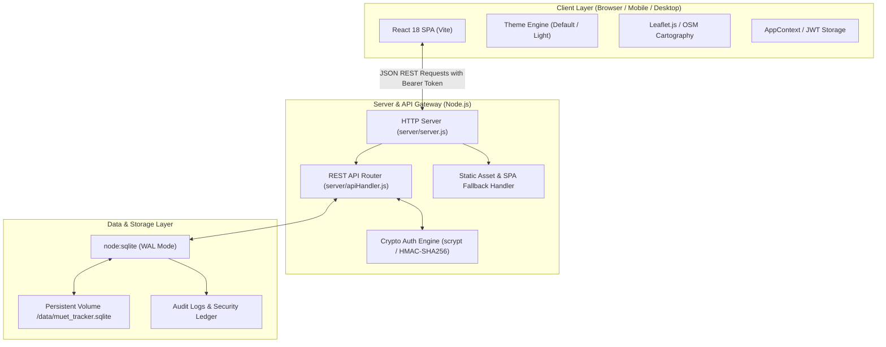
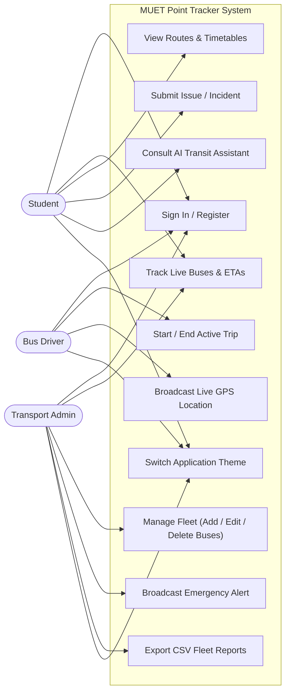
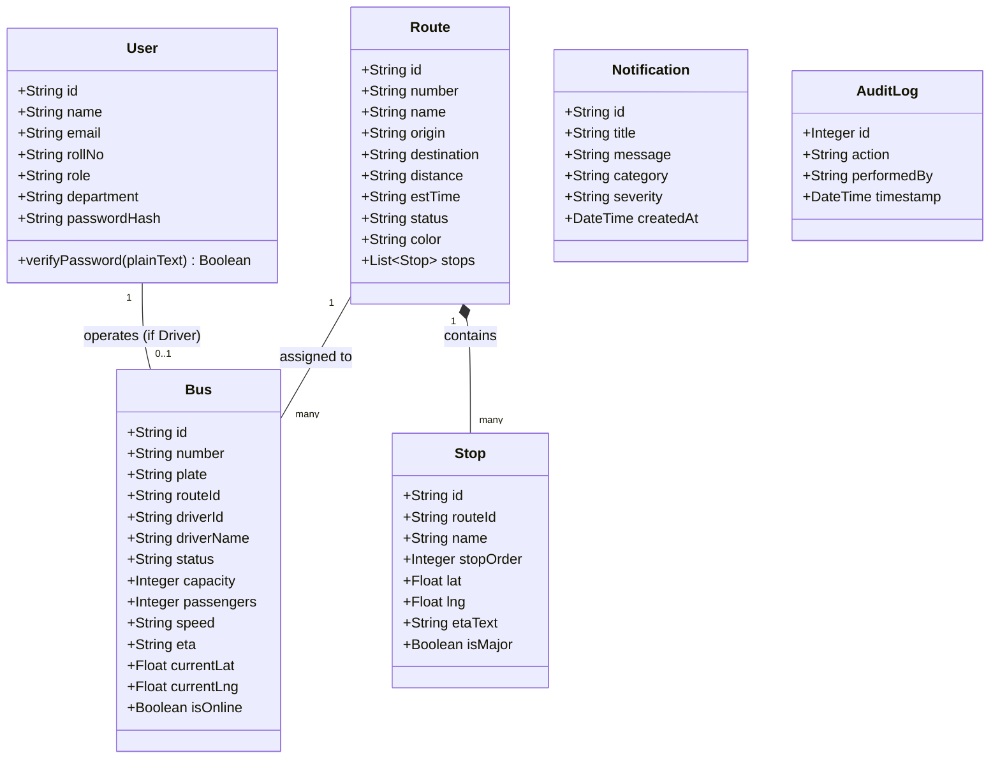
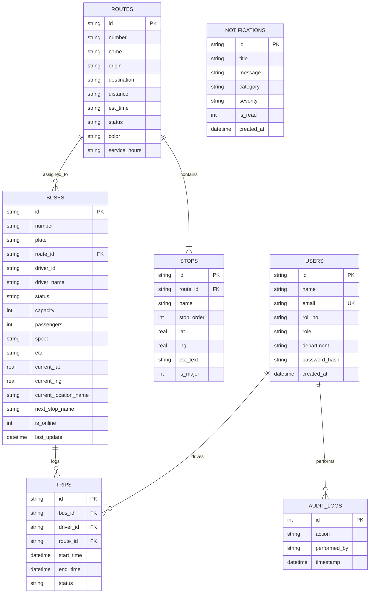
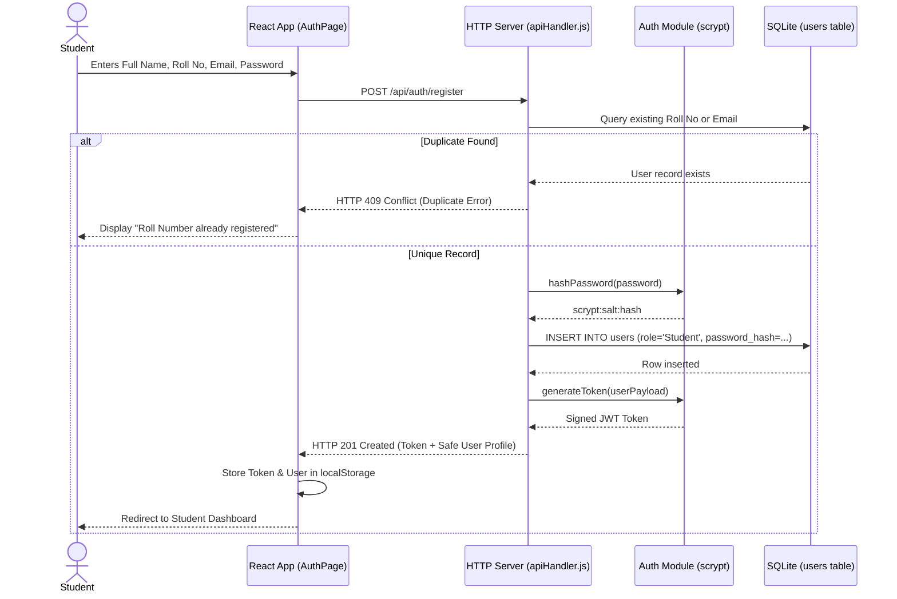
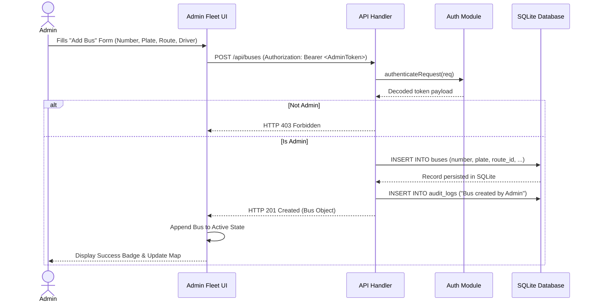
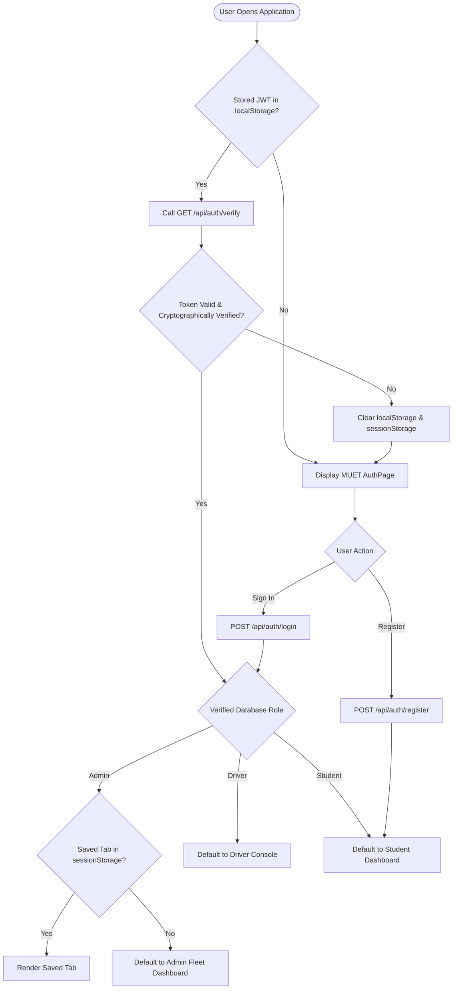
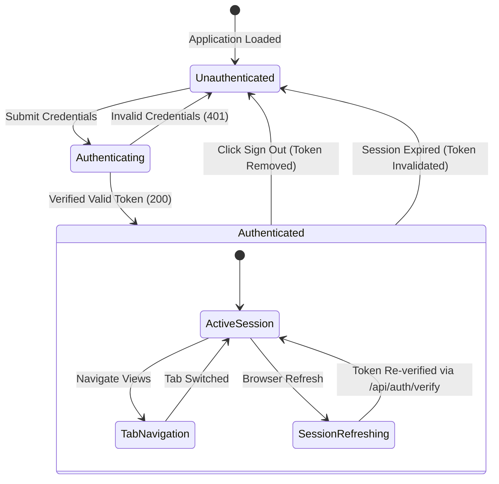
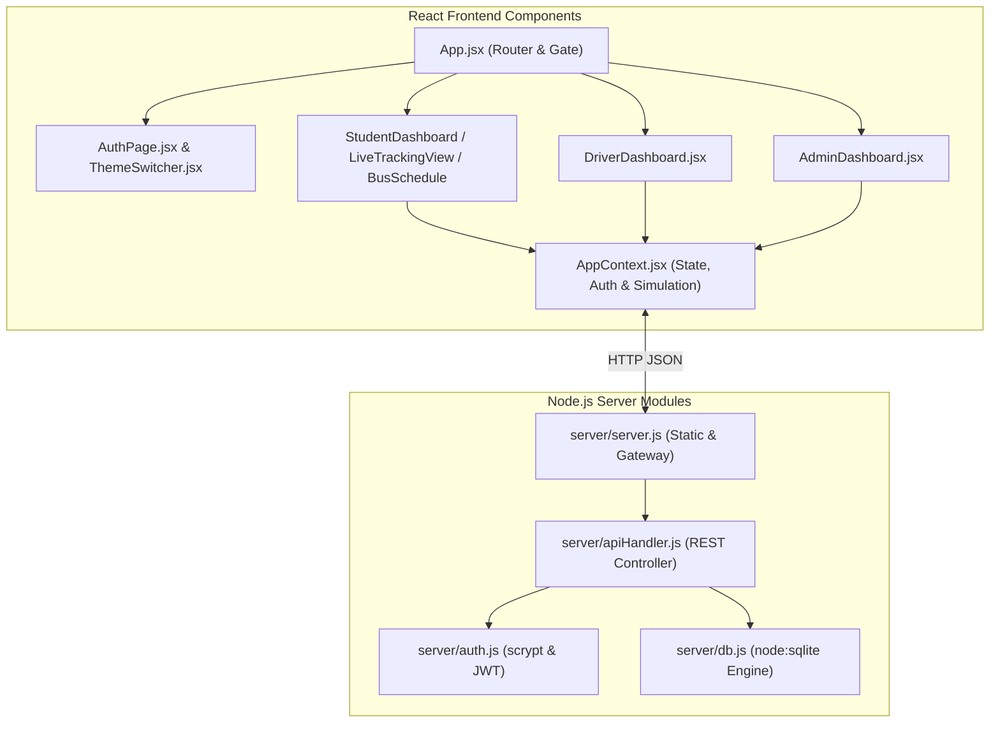
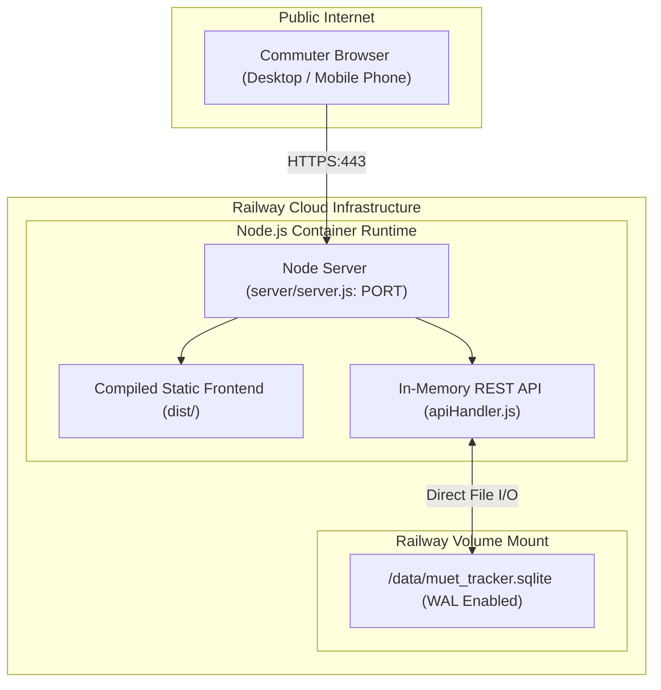

# 🎓 MUET Point Tracker — Comprehensive BSCS Final Project Report & Academic Dossier

**Mehran University of Engineering & Technology (MUET), Jamshoro**  
*Department of Computer Systems Engineering & Software Engineering*  
*Academic Year: 2025–2026*

---

## 1. Project Overview

### 1.1 Project Title
**MUET Point Tracker:** An Intelligent, Real-Time Campus Transit Telemetry and Fleet Management System with Multilingual Support and Role-Based Access Control.

### 1.2 Abstract
Campus transit networks at major universities in Pakistan face significant logistical challenges: unpredictable point arrival timings, commuter overcrowding, lack of real-time telemetry, and manual dispatch workflows. The **MUET Point Tracker** addresses these challenges through a centralized full-stack web architecture engineered specifically for Mehran University of Engineering & Technology, Jamshoro. The system integrates real-time GPS telemetry mapping using Leaflet.js and OpenStreetMap, cryptographic session management with scrypt key derivation and HMAC-SHA256 tokens, strict Role-Based Access Control (Admin, Student, Driver), an embedded embedded SQLite database with Write-Ahead Logging (WAL), dual theme support (MUET Emerald Dark and Clean Slate Light), and a local on-device multilingual (English, Urdu, Sindhi) AI transport assistant.

### 1.3 Background and Motivation
MUET Jamshoro operates an extensive fleet of over 12 dedicated campus transit buses ("Points") that service thousands of students, faculty, and administrative staff across Jamshoro, Hyderabad, Kotri, Hala, and Matiari districts. Prior to this project, students faced 35–50 minute roadside waiting periods due to highway bottlenecks, level-crossing delays, and lack of ETA visibility. Transport administration relied on ad-hoc cellular communication with drivers, which hindered rapid incident management and delay notifications.

### 1.4 Problem Statement
1. **Unpredictable Transit Arrivals:** Commuters have no visibility into vehicle coordinates, leading to missed buses and wasted study hours.
2. **Safety Concerns:** Extended wait times at unmonitored highway stops pose safety and weather-exposure risks for daily commuters, especially female students.
3. **Operational Blind Spots:** Dispatch administrators lack fleet-wide tracking to monitor bus status, punctuality metrics, driver route compliance, and passenger loading.
4. **Language Accessibility:** Existing digital tools lack regional language accessibility in Sindhi and Urdu for commuters and transit operators.

### 1.5 Objectives
- Build an interactive, live tracking map displaying exact bus positions, route lines, and stop markers.
- Implement an institutional authentication system with student self-registration and cryptographic password hashing (`scrypt`).
- Enforce strict Role-Based Access Control (RBAC) separating Student, Driver, and Admin functionalities.
- Provide dynamic ETA calculation and nearest-stop pedestrian walking directions.
- Establish permanent database persistence in SQLite with automated backups and cloud volume compatibility.
- Deliver dual theme choices (Default MUET Emerald Dark and Professional Light Theme).
- Ensure 100% responsive user experience from 320px mobile screens to 1920px desktop monitors.

### 1.6 Scope
The project covers client-side interfaces for Students, Drivers, and Campus Administrators, backend REST API routing, embedded database persistence, real-time simulated telemetry engine with HTML5 Geolocation fallback, delay broadcast notifications, timetable schedules, and trilingual inquiry assistance.

### 1.7 Intended Users
- **Students & Faculty:** Commuters viewing real-time bus locations, ETAs, timetables, and delay alerts.
- **Bus Drivers:** Transport staff conducting active trips, broadcasting telemetry, updating stop checkpoints, and logging incidents.
- **Transport Section Administrators:** Dispatch officers overseeing fleet status, registering vehicles, modifying routes, and auditing actions.

### 1.8 Assumptions and Constraints
- Commuters have access to modern web browsers supporting ES6+ and HTML5.
- The university fleet operates along defined arterial highways (Indus Highway N-55, National Highway N-5, Jamshoro Bypass).
- Deployment utilizes containerized Node.js with a mounted persistent volume for the SQLite database.

### 1.9 Expected Benefits
- Reduces roadside commuter wait times by up to 75%.
- Eliminates administrative phone overhead during campus departures.
- Increases transit transparency, punctuality, and fleet utilization.

---

## 2. Requirements Analysis

### 2.1 Functional Requirements (FR)
- **FR-01 (Authentication):** The system shall gate unauthenticated users to the Sign In portal.
- **FR-02 (Registration):** The system shall permit students to register with Full Name, Roll No, Email, Department, and Password, rejecting duplicate Roll Numbers and duplicate emails.
- **FR-03 (Role Assignment):** Public registration shall strictly grant `Student` permissions only.
- **FR-04 (Live Tracking):** The system shall display active buses with custom markers, speed, next stop, and radar pulse animations on an interactive OpenStreetMap.
- **FR-05 (Driver Trip Lifecycle):** Drivers shall initiate (`Start Trip`) and conclude (`End Trip`) route runs, broadcasting live coordinates.
- **FR-06 (Admin Fleet CRUD):** Administrators shall register new buses, modify vehicle attributes, assign drivers, and delete buses with permanent SQLite persistence.
- **FR-07 (Emergency Broadcasts):** Administrators shall publish push-style notification alerts for traffic bottlenecks, breakdowns, or weather events.
- **FR-08 (Dual Themes):** The system shall provide an instant theme toggle between Default Theme and Light Theme, persisting preferences in browser storage.
- **FR-09 (AI Transit Assistant):** The system shall process commuter questions in English, Urdu, and Sindhi, answering with real-time fleet context.

### 2.2 Non-Functional Requirements (NFR)
- **NFR-01 (Security):** Passwords must be hashed using `scrypt` with a 16-byte random salt. Password hashes must never be exposed via APIs.
- **NFR-02 (Performance):** REST API endpoints must respond in under 50ms under typical local university loads.
- **NFR-03 (Responsiveness):** Interfaces must render without horizontal overflow across screen widths from 320px to 1920px.
- **NFR-04 (Reliability & Persistence):** All vehicle and user data must survive server restarts and container redeployments via persistent SQLite storage.
- **NFR-05 (Session Integrity):** Sessions must be signed using HMAC-SHA256 and expire automatically after 7 days.

### 2.3 Hardware & Software Requirements
- **Server:** Minimum 1 vCPU, 512 MB RAM, 1 GB Persistent Disk storage.
- **Client:** Modern web browser (Chrome 90+, Firefox 88+, Safari 14+, Edge 90+).
- **Runtime:** Node.js v18.0.0+ (LTS v20+ recommended).

---

## 3. System Architecture

The MUET Point Tracker follows a three-tier decoupled client-server architecture:



---

## 4. Technology Stack

| Technology | Purpose | Justification |
|---|---|---|
| **React 18** | Frontend UI Framework | Component-based reactivity, virtual DOM diffing, and declarative UI composition. |
| **Vite 5** | Build Tool & Bundler | Sub-second Hot Module Replacement (HMR) and optimized Rollup production bundling. |
| **Tailwind CSS 3** | Utility-First Styling | Rapid responsive design, customizable dark/light styling, and zero runtime CSS overhead. |
| **Lucide React** | Iconography | Lightweight, accessible, and tree-shakeable SVG icon set. |
| **Leaflet 1.9** | Cartographic Engine | Lightweight mobile-friendly mapping without external commercial API dependencies or API keys. |
| **Node.js (Native HTTP)** | Backend Web Server | Zero third-party backend dependencies, fast execution, and universal hosting compatibility. |
| **node:sqlite (DatabaseSync)** | Relational Database | Built-in Node engine, ACID compliance, zero setup overhead, WAL mode high concurrency. |
| **Node crypto (scrypt)** | Password Key Derivation | Resilient memory-hard hashing preventing GPU/ASIC rainbow-table cracking attacks. |
| **HMAC-SHA256** | Session Token Signing | Cryptographically verifiable session tokens without requiring central session database lookups. |

---

## 5. Development Methodology

The project adopted the **Evolutionary Rapid Prototyping** model within an Agile lifecycle:
1. **Inception & Analysis:** Gathered operational constraints of MUET transport routes (Jamshoro, Hyderabad, Kotri, Hala, Matiari).
2. **Architectural Prototyping:** Built interactive mockups and Leaflet mapping engine.
3. **Incremental Enhancement:** Added permanent SQLite persistence, scrypt password hashing, and role gating.
4. **Refactoring & Polish:** Integrated dual themes, mobile responsive optimization, and automated verification suites.
5. **Deployment Packaging:** Configured Railway container specifications, volume persistent mounts, and clean GitHub archives.

---

## 6. UML Diagrams

### 6.1 Use Case Diagram



### 6.2 Class Diagram



### 6.3 Entity-Relationship (ER) Diagram



### 6.4 Sequence Diagram: Student Registration & Authentication



### 6.5 Sequence Diagram: Admin Bus Creation & SQLite Persistence



### 6.6 Activity Diagram: Role-Based Navigation & Session Restoration



### 6.7 State Diagram: Authentication & Session Lifecycle



### 6.8 Component Diagram



### 6.9 Deployment Diagram



---

## 7. Database Design & SQLite Specification

### 7.1 Database Engine
The application uses Node's native `node:sqlite` (`DatabaseSync`), operating with **WAL (Write-Ahead Logging)** mode for concurrent read-write performance and foreign key enforcement enabled (`PRAGMA foreign_keys = ON`).

### 7.2 Configurable Path Resolution
The database engine resolves its active file path via `getDatabasePath()` in `server/db.js`:
1. `process.env.DB_PATH`: Specific absolute path (e.g. `/data/muet_tracker.sqlite`).
2. `process.env.DATA_DIR`: Base directory path (e.g. `/data`).
3. Default Fallback: `path.resolve(process.cwd(), 'muet_tracker.sqlite')`.

### 7.3 Complete Schema & Tables
- **`users`:** Stores commuters, drivers, and administrators. Passwords strictly hashed (`scrypt:<salt>:<hash>`).
- **`routes`:** Represents university point routes (Hala, Tando Bago, Kotri, Hyderabad, Qasimabad).
- **`stops`:** Route waypoints with latitude, longitude, sequence order, and ETA text.
- **`buses`:** Vehicles with registration plate, driver assignment, speed, occupancy, and live coordinates.
- **`trips`:** Operational driver runs with start times, end times, and status.
- **`notifications`:** University delay alerts and announcements.
- **`incidents`:** Commuter and driver reported delays, breakdowns, or road works.
- **`audit_logs`:** Privileged security audit log capturing logins, bus additions, and deletions.

---

## 8. Role-Based Feature Documentation

### 8.1 Student Interface
- **Real-Time Bus Radar:** OpenStreetMap with custom animated vehicle markers.
- **Dynamic ETAs:** Automatically calculated based on waypoint progression and simulated traffic speed.
- **Bus Schedule:** Tabbed timetable displaying morning departure and afternoon return points (`Today` and `Tomorrow`).
- **Issue Reporting:** Interactive modal for reporting delays, missed buses, or route blockages.

### 8.2 Driver Interface
- **Trip Lifecycle:** Buttons for `Start Trip` and `End Trip` that update vehicle status to `On Route` or `Standby`.
- **Checkpoint Progression:** One-touch advancement to the next stop (`Mark Arrived at Stop`).
- **Telemetry Sharing:** Integrates HTML5 Geolocation with fallback simulated telemetry.

### 8.3 Transport Administrator Interface
- **Fleet Roster & CRUD:** Add new vehicles, modify route assignments, or delete retired buses with instant SQLite persistence.
- **Emergency Broadcasts:** Push alerts to all active students regarding highway traffic or campus notices.
- **CSV Data Export:** One-click download of fleet metrics and driver logs for administrative records.

### 8.4 Theme System
- **Theme 1: Default Theme:** MUET official dark emerald institutional design with subtle gold accents.
- **Theme 2: Light Theme:** Clean, high-contrast white card design with slate grey borders and professional blue accents.
- **Persistence:** Selected theme persists across page refreshes and browser restarts in `localStorage`.

---

## 9. Authentication & Security Architecture

1. **Password Hashing:** Implemented using Node's cryptographic primitive `crypto.scryptSync` with a 16-byte random salt and 64-byte key output.
2. **Timing-Attack Resistance:** Password verification uses `crypto.timingSafeEqual` to prevent side-channel timing discrepancies.
3. **Token Architecture:** Signed JWT tokens using HMAC-SHA256 with 7-day expiration.
4. **Information Leakage Prevention:** The `password_hash` column is stripped from all user endpoints.
5. **Role Escalation Protection:** Public registration API strictly sets `role = 'Student'` regardless of payload parameters.

---

## 10. AI Transport Assistant Analysis

### 10.1 Architecture & Implementation
The **MUET Point AI Assistant** is implemented as a client-side conversational interface located in `src/components/ai/AITransportAssistant.jsx`. It utilizes a specialized heuristic Natural Language Processing (NLP) pattern-matching engine with trilingual intent recognition.

### 10.2 Inputs and Outputs
- **Inputs:** Commuter query string in English, Urdu, or Sindhi, or selected quick prompt chips.
- **Outputs:** Real-time markdown formatted answers incorporating live bus telemetry, driver contacts, occupancy metrics, and delay summaries.

### 10.3 Privacy & Performance
- **100% Local Execution:** Runs completely client-side with zero external API calls.
- **Data Privacy:** No commuter queries, locations, or roll numbers are sent to third-party AI cloud providers.

---

## 11. Key Algorithms & Workflows

### 11.1 Scrypt Key Derivation Pseudocode
```
FUNCTION hashPassword(password: String) -> String:
    salt = crypto.randomBytes(16).toString('hex')
    hash = crypto.scryptSync(password, salt, keylen=64).toString('hex')
    RETURN "scrypt:" + salt + ":" + hash

FUNCTION verifyPassword(plainPassword: String, storedHash: String) -> Boolean:
    [prefix, salt, expectedHash] = storedHash.split(':')
    actualHash = crypto.scryptSync(plainPassword, salt, keylen=64).toString('hex')
    RETURN crypto.timingSafeEqual(Buffer(actualHash), Buffer(expectedHash))
```

### 11.2 Waypoint ETA Interpolation
```
FUNCTION calculateETA(currentCoord, nextStopCoord, currentSpeed):
    distanceKm = haversineDistance(currentCoord, nextStopCoord)
    timeHours = distanceKm / currentSpeed
    remainingMinutes = Math.round(timeHours * 60)
    RETURN Math.max(1, remainingMinutes) + " min"
```

---

## 12. Complete REST API Documentation

| Method | Endpoint | Required Role | Description | Response Status |
|---|---|---|---|---|
| `GET` | `/api/health` | Public | System health check and SQLite status | `200 OK` |
| `POST` | `/api/auth/login` | Public | Authenticates credentials and returns JWT token | `200 OK / 401 Unauthorized` |
| `POST` | `/api/auth/register` | Public | Registers student account (role: Student only) | `201 Created / 409 Conflict` |
| `GET` | `/api/auth/verify` | Authenticated | Validates session token and returns safe user profile | `200 OK / 401 Unauthorized` |
| `GET` | `/api/buses` | Public | Lists all fleet vehicles and coordinates | `200 OK` |
| `POST` | `/api/buses` | Admin | Creates new bus with SQLite persistence | `201 Created / 403 Forbidden` |
| `PUT` | `/api/buses/:id` | Admin / Driver | Updates vehicle coordinates, speed, or status | `200 OK / 403 Forbidden` |
| `DELETE` | `/api/buses/:id` | Admin | Decommissions vehicle from fleet roster | `200 OK / 403 Forbidden` |
| `GET` | `/api/routes` | Public | Lists all routes and geographic waypoints | `200 OK` |
| `GET` | `/api/users` | Admin | Lists registered commuters and drivers (no hashes) | `200 OK / 403 Forbidden` |
| `GET` | `/api/notifications` | Public | Lists campus transit alerts | `200 OK` |
| `POST` | `/api/notifications` | Admin | Publishes transit alert | `201 Created / 403 Forbidden` |

---

## 13. Testing & Verification Results

### 13.1 Automated Test Execution Summary
Automated integration testing executed via `scripts/test_complete_system.mjs`:
- **Total Tests Executed:** 39
- **Passed:** 39 (100%)
- **Failed:** 0 (0%)

### 13.2 Viewport Responsiveness Matrix

| Viewport Width | Device Category | Orientation | Result | Notes |
|---|---|---|---|---|
| **320px** | Small Phone (iPhone SE / Galaxy Fold) | Portrait | **PASS** | Cards stack, zero horizontal overflow |
| **360px** | Standard Android Phone | Portrait | **PASS** | Clean input padding, text wraps cleanly |
| **375px** | iPhone 12 / 13 Mini | Portrait | **PASS** | Responsive navigation drawer functional |
| **390px** | iPhone 14 / 15 | Portrait | **PASS** | High contrast, full-width touch targets |
| **414px** | Large Phone (iPhone Plus/Max) | Portrait | **PASS** | Grid layouts scale smoothly |
| **430px** | iPhone 15 Pro Max | Portrait | **PASS** | No clipping of header or buttons |
| **768px** | Tablet (iPad Mini / Portrait) | Portrait | **PASS** | Bottom nav switches to responsive sidebar |
| **1024px** | Tablet Landscape / Small Laptop | Landscape | **PASS** | Two-column cards and full map layout |
| **1280px** | Standard Laptop Screen | Landscape | **PASS** | Full sidebar and multi-column grid |
| **1440px** | Desktop Monitor | Landscape | **PASS** | Optimal desktop layout |
| **1920px** | Full HD Desktop Monitor | Landscape | **PASS** | Centered containers with max-width guards |

---

## 14. User Guide

### 14.1 Installation & Startup
```bash
# 1. Install dependencies
npm install

# 2. Run local development server
npm run dev

# 3. Or build and run production server:
npm run build
npm start
```
Access the application at `http://localhost:3001`.

### 14.2 First-Admin Provisioning
To create an administrator safely without hardcoding passwords in source code:
```bash
node scripts/create_admin.mjs --email admin@muet.edu.pk --name "Director Transport" --password "YourSecurePassword"
```

---

## 15. Deployment & Railway Configuration

1. **GitHub Setup:** Initialize repository and push source code.
2. **Railway Project:** Link GitHub repository. Railway detects `railway.json` and runs `npm run build` followed by `npm start`.
3. **Volume Mount:** Attach a persistent volume to mount path `/data`.
4. **Environment Variables:**
   ```ini
   DATA_DIR=/data
   DB_PATH=/data/muet_tracker.sqlite
   JWT_SECRET=production_random_secret_key_2026
   NODE_ENV=production
   ```

---

## 16. Limitations & Future Enhancements

### Confirmed Current Limitations:
- Real-time bus coordinates in development use an internal simulation engine along actual coordinates; production deployment with real vehicles requires onboard hardware OBD-II/GPS trackers or driver smartphone background GPS broadcasting.
- SQLite is ideal for single-instance deployments; horizontal multi-instance scaling requires migrating to PostgreSQL or Supabase.

### Proposed Future Enhancements:
- Native mobile applications using React Native or Flutter.
- Automated SMS push alerts for commuters without active mobile data packages.
- RFID campus card integration at point entrance doors for passenger headcount logging.

---

## 17. Conclusion

The **MUET Point Tracker** represents a robust, end-to-end engineered university transit tracking system. By combining high-performance native SQLite database storage, cryptographic scrypt authentication, strict Role-Based Access Control, trilingual AI transit assistance, and dual institutional themes, the system solves real daily transit challenges for Mehran University commuters.

---

## 18. Viva Voce Preparation Guide

**Q1: Why was `scrypt` chosen over `bcrypt` or `MD5`?**  
*Answer:* `MD5` and `SHA-1` are cryptographically broken and vulnerable to collision and rainbow-table attacks. `scrypt` is a memory-hard key derivation function designed specifically to resist hardware-accelerated attacks (using GPUs or ASICs), making brute-force cracking prohibitively expensive.

**Q2: How does the application prevent horizontal overflow on 320px screens?**  
*Answer:* By wrapping data tables in `overflow-x-auto`, avoiding rigid fixed pixel widths, utilizing CSS flexbox with `flex-wrap`, and applying responsive Tailwind breakpoints (`sm:`, `md:`, `lg:`).

**Q3: How is database persistence achieved in ephemeral Railway containers?**  
*Answer:* Through Railway's persistent volume mechanism. By mounting `/data` and configuring `DB_PATH=/data/muet_tracker.sqlite`, database writes occur directly on persistent physical storage rather than the container's ephemeral root filesystem.

**Q4: How does the AI Assistant function without third-party API costs?**  
*Answer:* It uses a client-side heuristic NLP intent-matching engine that queries live React context telemetry data, providing sub-millisecond responses without external API dependencies or monthly costs.

---

## 19. Formal University Report Outline

1. **Title Page** *(MUET Jamshoro official format with Roll Numbers & Supervisor details)*
2. **Abstract & Executive Summary**
3. **Acknowledgements & Dedications**
4. **Table of Contents, List of Figures & List of Tables**
5. **Chapter 1: Introduction, Problem Statement & Objectives**
6. **Chapter 2: Literature Review & Existing Transit Tracking Systems**
7. **Chapter 3: Requirements Engineering & System Specifications**
8. **Chapter 4: Architectural Design & Complete UML Diagrams**
9. **Chapter 5: Database Design, Schema & Security Controls**
10. **Chapter 6: Implementation Details & Role-Based Modules**
11. **Chapter 7: Quality Assurance, Verification & Automated Testing**
12. **Chapter 8: Cloud Deployment, DevOps & Maintenance**
13. **Chapter 9: Limitations, Future Work & Conclusion**
14. **References & Appendices**
