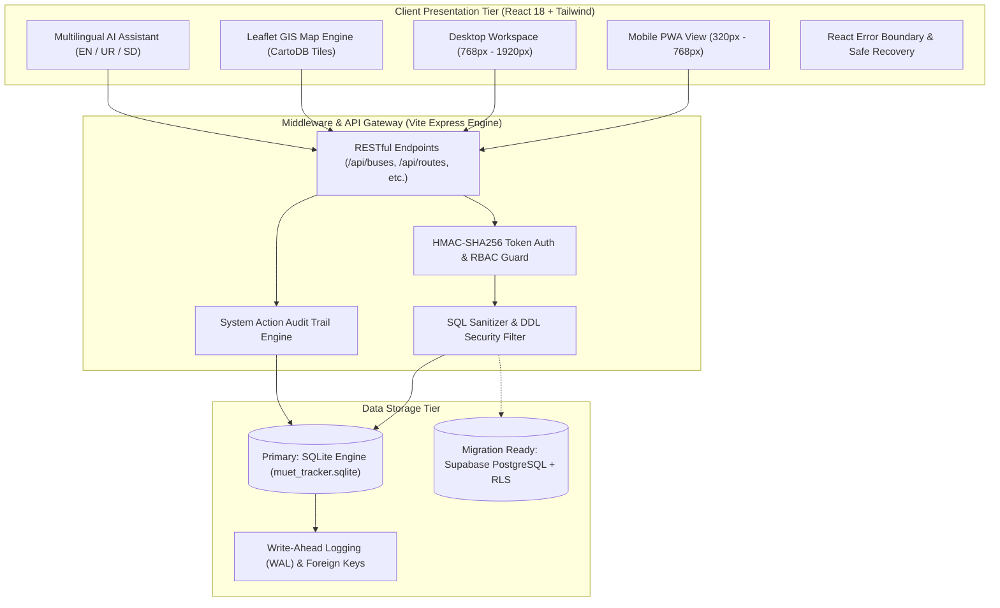
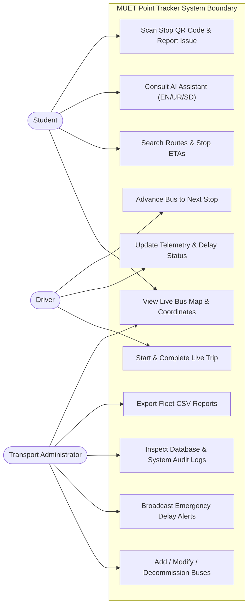
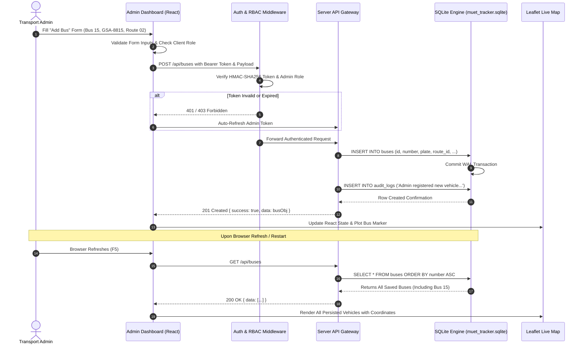
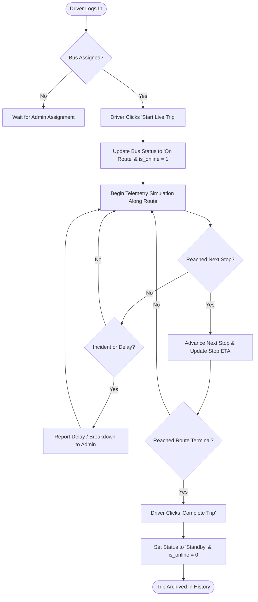
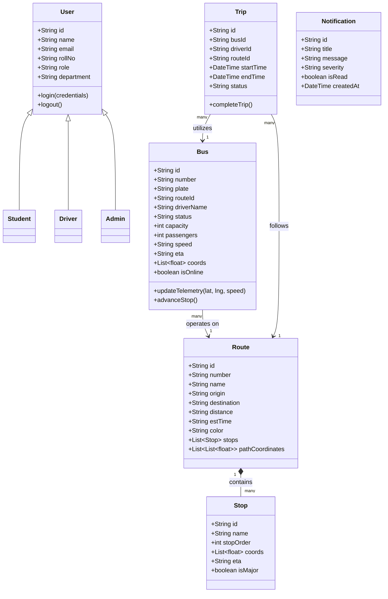
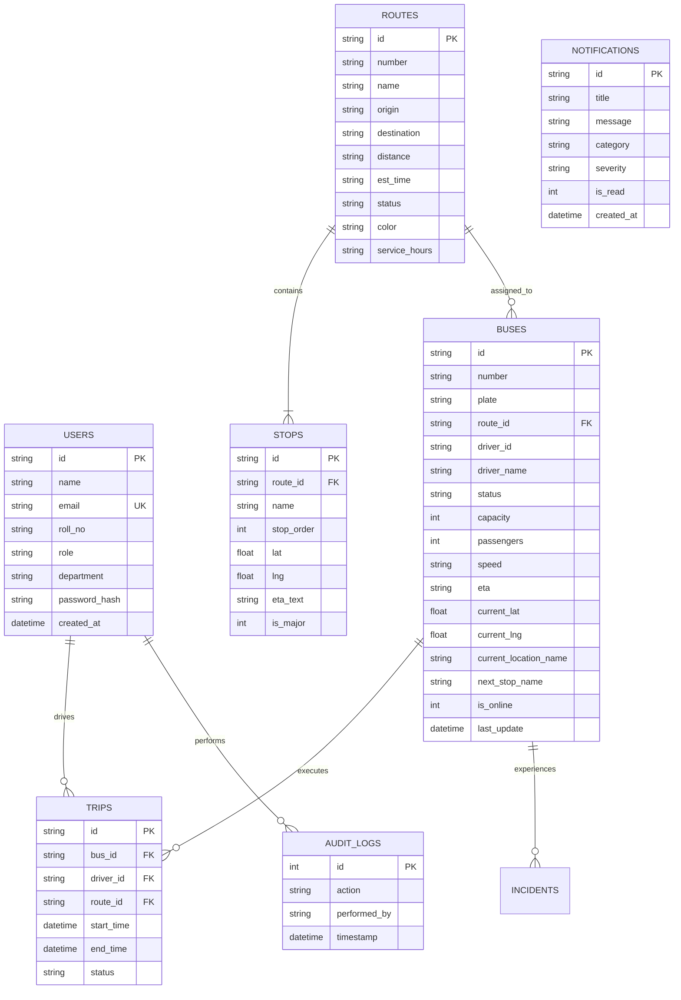

# System Architecture & UML Design Models
## MUET Point Tracker — Mehran University of Engineering & Technology

---

## 1. System Architecture Diagram

---

## 2. Use Case Diagram

---

## 3. Sequence Diagram: Bus Registration & Persistence Lifecycle

---

## 4. Activity Diagram: Driver Trip Telemetry Execution

---

## 5. Class Diagram

---

## 6. Entity-Relationship (ER) Diagram

